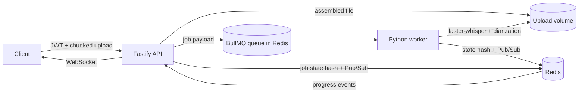

# AMP

Audio processing and transcription engine. A Fastify API accepts chunked audio uploads, authenticates users and queues transcription jobs. Python workers consume the same BullMQ queue, run local speech recognition with faster-whisper, label speakers, optionally render a speech readback, then publish results over Redis Pub/Sub.

No audio leaves the host. Uploads, transcription and diarization all run locally.

## Architecture



The job state lives in a Redis hash (`amp:job:<id>`) and every transition is published on `amp:events`. The API subscribes once and fans events out to authenticated WebSocket clients, so any number of API replicas stay consistent.

BullMQ is the transport between the two languages. The worker uses the official Python port (`bullmq`) so job ids, retries and progress are shared instead of mirrored. Redis Pub/Sub carries application events, which keeps the websocket layer independent from queue internals.

## Layout

```
amp/
  node-api/          Fastify ingestion API, auth, upload assembly, BullMQ producer, WebSocket bridge
  py-worker/         BullMQ consumer, faster-whisper transcription, diarization, optional TTS
  docker-compose.yml Redis, API and worker with shared volumes
```

## Quickstart

```bash
cp .env.example .env
# set JWT_SECRET in .env
docker compose up --build
```

The first job downloads the selected Whisper model into the `models` volume. `base` is the default; set `WHISPER_MODEL=small` or `medium` for better accuracy at a higher cost.

The API listens on `http://localhost:8080`. Check it:

```bash
curl http://localhost:8080/healthz
```

## Upload and transcribe

Create an account:

```bash
curl -s -X POST http://localhost:8080/auth/register \
  -H "content-type: application/json" \
  -d '{"email":"you@example.com","password":"a-long-password"}'
```

Use the returned token:

```bash
export TOKEN="<token>"
export FILE="meeting.wav"
export SIZE=$(wc -c < "$FILE")
export CHUNK=4194304
export COUNT=$(( (SIZE + CHUNK - 1) / CHUNK ))

curl -s -X POST http://localhost:8080/uploads \
  -H "authorization: Bearer $TOKEN" \
  -H "content-type: application/json" \
  -d "{\"filename\":\"meeting.wav\",\"contentType\":\"audio/wav\",\"totalChunks\":$COUNT,\"sizeBytes\":$SIZE}"
```

The response contains `uploadId`. Send each chunk with a zero-based index:

```bash
split -b 4194304 -d -a 4 "$FILE" chunk-
i=0
for part in chunk-*; do
  curl -s -X PUT "http://localhost:8080/uploads/$UPLOAD_ID/chunks/$i" \
    -H "authorization: Bearer $TOKEN" \
    -H "content-type: application/octet-stream" \
    --data-binary "@$part"
  i=$((i + 1))
done
```

Complete the upload. Chunks are verified, concatenated inside the storage volume and compared against the declared byte size before a job is queued.

```bash
curl -s -X POST "http://localhost:8080/uploads/$UPLOAD_ID/complete" \
  -H "authorization: Bearer $TOKEN" \
  -H "content-type: application/json" \
  -d '{"language":"auto","diarize":true,"tts":false}'
```

The response is `202` with a `jobId`. Poll `GET /jobs/:jobId` or connect to `ws://localhost:8080/ws?token=$TOKEN` for live events.

### WebSocket events

```json
{"type":"job.running","jobId":"...","userId":"...","status":"running","stage":"diarizing","progress":78}
{"type":"job.completed","jobId":"...","userId":"...","status":"completed","stage":"completed","progress":100}
```

Only events for the authenticated user are forwarded. The socket closes with code `4401` when the token is missing or invalid.

## API

| Method | Path | Notes |
| --- | --- | --- |
| POST | `/auth/register` | Email and password (minimum 8 characters). Returns JWT |
| POST | `/auth/login` | Returns JWT |
| GET | `/auth/me` | Current user |
| POST | `/uploads` | Declares filename, content type, chunk count and total bytes |
| PUT | `/uploads/:id/chunks/:index` | Raw `application/octet-stream` chunk |
| POST | `/uploads/:id/complete` | Verifies and assembles chunks, queues the job |
| DELETE | `/uploads/:id` | Cancels an upload and removes partial files |
| GET | `/jobs` | Latest jobs for the current user |
| GET | `/jobs/:id` | Full job state and result |
| GET | `/ws?token=...` | Authenticated progress stream |
| GET | `/healthz` | Redis ping and queue counts |

Errors are returned as `{"error": "code"}`. Validation failures add a `details` array.

## Job result

```json
{
  "text": "full transcript",
  "language": "en",
  "languageProbability": 0.98,
  "model": "base",
  "durationSeconds": 91.4,
  "speakerCount": 2,
  "diarization": {"enabled": true, "method": "mfcc-kmeans-silhouette"},
  "segments": [
    {"start": 0.0, "end": 4.2, "text": "We should start.", "speaker": "SPEAKER_00"},
    {"start": 4.2, "end": 9.8, "text": "Right, agenda first.", "speaker": "SPEAKER_01"}
  ],
  "turns": [
    {"speaker": "SPEAKER_00", "start": 0.0, "end": 4.2, "text": "We should start."}
  ]
}
```

`readback` is added when TTS was requested and a speech backend is available.

## Diarization

The worker does not download a speaker embedding model. After transcription it builds segment-level MFCC statistics from the normalized 16 kHz audio, standardizes them, and clusters with k-means over `k = 2..max_speakers`. The number of speakers is chosen with a silhouette score, and clusters below the separation threshold collapse to one speaker.

This is deliberately small and CPU friendly. It separates clear conversational turns and handles overlapping speakers less reliably than a neural diarization pipeline such as pyannote. The result reports the method so consumers can treat labels accordingly.

## Configuration

| Variable | Default | Used by |
| --- | --- | --- |
| `PORT` | `8080` | API |
| `REDIS_URL` | `redis://127.0.0.1:6379` | both |
| `JWT_SECRET` | development placeholder | API, required when `NODE_ENV=production` |
| `JWT_EXPIRES_IN` | `12h` | API |
| `STORAGE_DIR` | `./data/uploads` | API |
| `MAX_UPLOAD_BYTES` | `209715200` | API |
| `MAX_CHUNK_BYTES` | `8388608` | API and upload chunk size |
| `QUEUE_NAME` | `amp-transcribe` | both |
| `EVENTS_CHANNEL` | `amp:events` | both |
| `CORS_ORIGIN` | unset | API |
| `WHISPER_MODEL` | `base` | worker |
| `WHISPER_DEVICE` | `cpu` | worker |
| `WHISPER_COMPUTE_TYPE` | `int8` | worker |
| `WORKER_CONCURRENCY` | `1` | worker |
| `AMP_STORAGE_ROOT` | `./data/uploads` | worker path guard |
| `AMP_OUTPUT_DIR` | `./data/results` | worker |
| `TTS_ENABLED` | `false` | worker |
| `HF_HOME` | `/models` in the image | worker model cache |

`AMP_STORAGE_ROOT` is a security boundary. A job whose file resolves outside that root is rejected before any processing.

## Local development

Redis is the only external service.

```bash
# terminal 1
redis-server

# terminal 2
cd node-api
npm install
REDIS_URL=redis://127.0.0.1:6379 JWT_SECRET=dev-secret npm run dev

# terminal 3
cd py-worker
python -m venv .venv
.venv/Scripts/pip install -e ".[dev]"      # Windows
# .venv/bin/pip install -e ".[dev]"        # Linux or macOS
AMP_STORAGE_ROOT=../node-api/data/uploads \
AMP_OUTPUT_DIR=../node-api/data/results \
REDIS_URL=redis://127.0.0.1:6379 \
.venv/Scripts/python -m amp_worker.main
```

The worker installs faster-whisper, which is a large dependency. `pip install bullmq redis numpy pytest` is enough to run the test suite without model downloads.

## Tests

```bash
cd node-api && npm test
cd py-worker && .venv/Scripts/python -m pytest
```

Node tests use an in-memory Redis and queue double to exercise auth, chunk assembly, ownership checks and enqueue failure paths. Python tests cover WAV handling, diarization on synthetic two-speaker audio, pipeline orchestration with a stub transcriber, and Pub/Sub event shape.

## Operational notes

- Source audio and results are retained. Add a lifecycle policy or a cleanup job when this is deployed with real user data.
- Audio is assembled by concatenating chunk files, then validated against the declared size. Declared size and chunk count limits are enforced before writing.
- A failed job retries three times with exponential backoff. The last failure is reflected in the job hash and over WebSocket.
- `faster-whisper` downloads models on first use. Pre-pull the model in a deployment step if cold starts matter.
- TTS depends on `pyttsx3` and a host speech backend (`espeak-ng` in the image). When unavailable, the readback is omitted and the transcription still succeeds.
